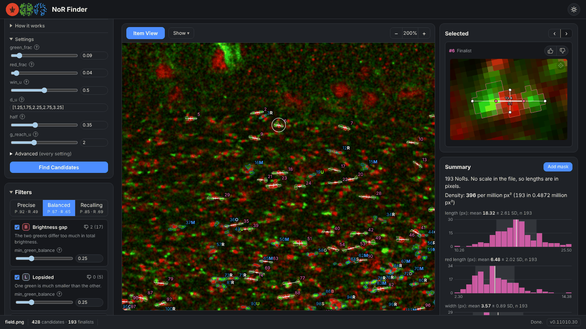

# NoRFinder

**Open the site: [rauntruth.com](https://rauntruth.com/)**

A page that turns fluorescence-microscopy images into numbers a researcher can check, and gathers
their corrections as ground truth. It runs entirely in the browser, and each analysis on it is a
*study*, picked from the title at the top of the page or opened by its address. The page opens on
the Image Viewer, which only shows an image; the first study is NoR Finder, at
[rauntruth.com/nor](https://rauntruth.com/nor).

## NoR Finder, the first study

NoR Finder is for neuroscience researchers who count and measure Nodes of Ranvier in
immunofluorescence images of CNS tissue. Node number and node length change in myelin injury,
and doing either by hand means scanning hundreds of tiny Caspr–Nav1.6–Caspr triplets per image.
The page does that first pass for you, and you keep the final say: you review each candidate,
accept or reject it, correct its length, and add any node it missed.

It is built to turn a microscope image into numbers you can trust and check. You load a
three-channel ImageJ TIFF (Caspr, Nav1.6, DAPI) or an RGB PNG, from your computer or a shared
Google Drive folder. A finder proposes every candidate node, and a set of named, tunable filters
splits them into finalists and rejects, each reject showing the reason. The page then reports
count, density and length histograms for the whole image or a lassoed region, and exports them
as CSV. Your verdicts can go back to this repository as ground truth, which is what the finders
are tuned and scored against.

All of it runs in your browser: images are analysed on your own machine, never uploaded to a
server. The image analysis is the
study's own Python code (`studies/nor/detection/`), run under Pyodide (CPython compiled to WebAssembly)
with numpy, scipy and scikit-image, inside a Web Worker so the page stays responsive. A small
bridge passes the image in and the candidates and filter results back out. The JavaScript does
everything that isn't image analysis: drawing the image and its overlays, the item views, the
measurement editors, the summary statistics, the CSVs, the Drive browser and your saved settings.
The site is static files served by Cloudflare, with no build framework, and one small server
(`accounts/`, a Cloudflare Worker) for signing in, which is optional. Signing in with Google asks Google for
your name, email and picture, and nothing else. It keeps your session in one cookie, sent only to the
site's `/api/`, and keeps a small record of your settings so they follow you to other devices: the
theme, the tips you closed, where Load reads from, your last Drive link and the images you opened from
Drive lately. It also records when you were last seen, and logs each sign-in, sign-out and settings save
under your Google id; nobody but you is ever served your record. Your images, results and ground truth
never reach that server. Without signing in, nothing
is kept anywhere but your browser. It counts
visits with Cloudflare Web Analytics, which sets no cookies, stores nothing on your device and does
not follow you across sites; it receives the page's address, the page that
linked to it and your browser's details, never your images or results. Python and
its packages, about 50 MB, download on the first visit and are cached for 30 days. Images opened
from Google Drive are kept in your browser too, so they open again without a download, unless you
untick Auto-save images; your avatar's Manage storage lists, and deletes, everything kept.

## For contributors

Start here: **[docs/WARMUP.md](docs/WARMUP.md)** — the repo map: the shell, the study contract and
how to add a study.

- [dev/requirements/requirements.md](dev/requirements/requirements.md) — what the page must do:
  the shell's part, the repo's checks, each study's page
- [studies/nor/](studies/nor/docs/WARMUP.md) — the NoR Finder study: its brief, literature, finders
  and ground truth
- [studies/vascular/](studies/vascular/docs/WARMUP.md) — Vascular Measurements, cerebral vessels in CD31 images and z-stacks: its literature, extraction lab and data
